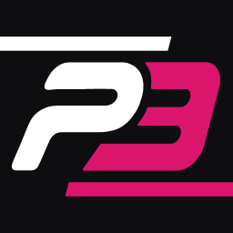
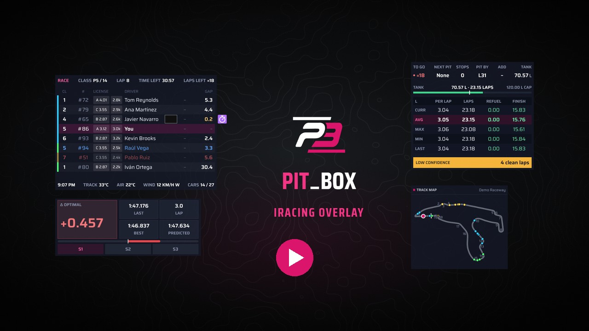
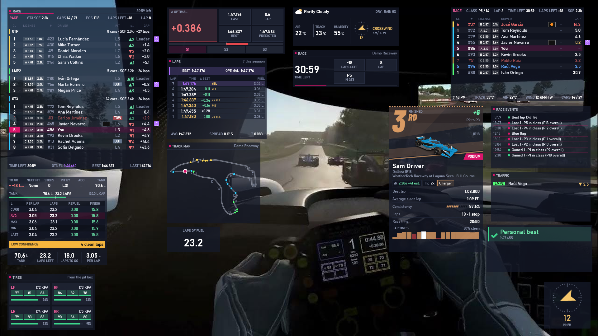
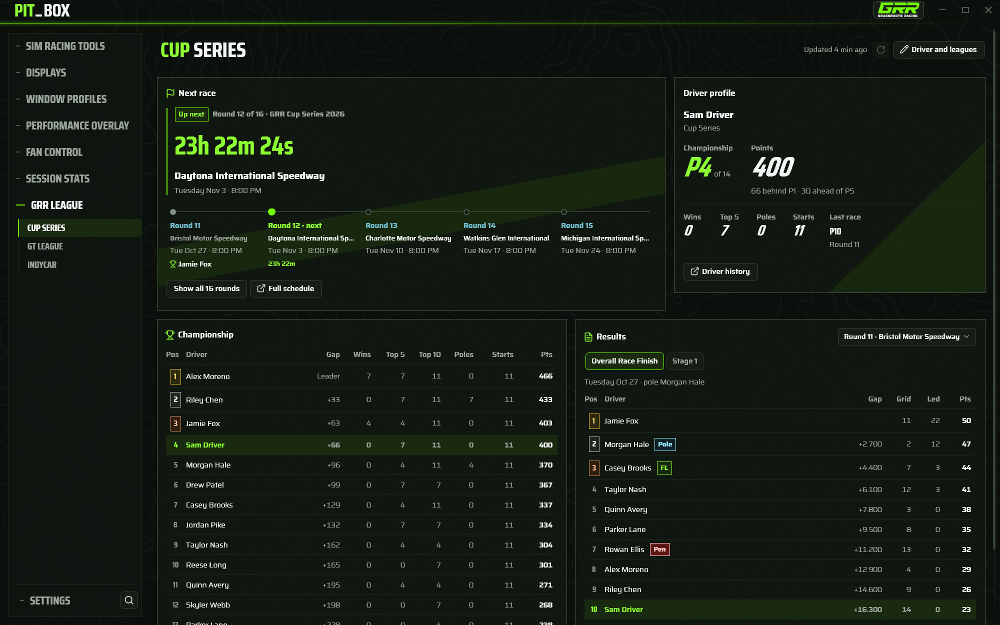

# Pit-Box

**One Windows app for the sim rig: overlays, setups, stats, displays, fans and windows.**

  

### [Download the latest release](https://github.com/king-tulip999/Pit-Box---A-windows-tool-kit-for-sim-racing/releases)

I got sick of setting everything up by hand every time I went from my desk to my sim rig, and of paying for a handful of subscriptions just to race. So I spent the last couple of years building one app that does it all. It sits in the tray, sets the PC up for whatever I'm doing, and has grown into the toolkit I use every time I race in iRacing. Now you can use it too.

## At a glance

| Tool | What it does |
| --- | --- |
| **iRacing Overlay** | Relative, standings, fuel and strategy, pit exit, radar, inputs, track map and more, edited in the car. |
| **Session Stats** | Your whole iRacing history on your PC: result cards, goals, lap analysis and replays. |
| **iRacing tools** | Setup manager, settings and keybinds in plain language, FOV calculator, bass shakers. |
| **Displays** | Monitors, resolution, HDR and audio saved as profiles you switch with a keybind. |
| **Window Profiles** | Any program at an exact size and spot, borderless, applied when it starts. |
| **Performance Overlay** | FPS, 1% lows, temperatures and usage over your game. |
| **Fan Control** | Curves, per-fan limits and a failsafe that hands fans back to the BIOS. |

**You don't have to use all of it.** The first time Pit-Box opens, you pick what you want it for: just the overlays, just the sim racing tools, just PC tuning, everything, or your own mix. Anything you don't pick stays off, with no page, keybind or background work. You can change it any time in Settings, or run setup again with **Run setup**.

## Features

Click a section to open it.

<b>iRacing Overlay</b>: 19 widgets, in-game editor, browser sources

 

- **Widgets:** Relative, Standings, Fuel and strategy, Lap timing and delta, Lap history, Tires, Weather and track, Wind, Session, Race events, Multiclass traffic, Alerts, Car radar, Track map, Inputs, Practice goals, Notes, a Race result after the race and a Data block for any single value.
- **Inputs:** throttle, brake, clutch and steering with gear, speed and shift lights, as a scrolling trace or a low shift-light bar.
- **Pit exit:** the Fuel widget shows where a stop right now would put you: your class position, the cars ahead and behind, traffic, and a ghost on a track strip. It learns the pit lane, fill rate and tire time per track and car.
- **Strategy:** fuel saving (what each lap may use to finish with one stop fewer) and undercut / overcut (what you'd need per lap to jump the car ahead, or to cover the one behind).
- **Practice goals:** clean or consistent laps in a row, laps close to your best or under a time, as a lap list or big counters.
- **Notes:** your notes per track and car, with the next corner's note lighting up as you get close.
- **Race result:** a card, a banner, a stamp or a lap chart once you take the flag.
- **Track limits:** off-tracks counted and placed by corner, with an alert from a threshold you pick.
- **Your layout:** every widget can be set up however you like, with layouts that switch by car / class / track. Colors: Default, your own, or any app theme’s (teams, custom color sets) from one menu.
- **In-game editor:** `Ctrl+Alt+E`, so you never have to leave the car.
- **Browser sources:** every widget is also a web page on your PC only (`127.0.0.1`), for a wheel screen, a tablet browser or OBS. Off by default (iRacing Overlay → Settings → Browser sources).

<b>Session Stats</b>: history, result cards, goals, lap analysis

 

Your iRacing history, kept on your PC.

- **History:** laps, time, results, ratings, incidents and personal bests by week / month / season, with a picture of each car. Panels can be dragged into your own order.
- **Result cards:** every race gets one with your finish, positions gained, rating changes, pace, consistency and awards (Win, Podium, Clean race, Personal best, Charger and more).
- **Goals:** set up to 6 goals for iRating or safety rating (per license), races, wins, podiums, clean races or hours (per car / track or this season). Reached goals are kept with their date and show on that race's result card.
- **Per car and track:** a report card, where your off-tracks happen on the map, and your notes.
- **Lap analysis:** open any session for its laps and sectors, then compare laps on telemetry traces (including brake bias, ABS and traction control) or a top-down replay, and see which corners cost the most time. Export a lap to share and import other people's.
- **Tire wear:** tracked per run from the pit-stall readings.
- **Old telemetry:** reads your old iRacing telemetry files so your history doesn't start from zero, can switch on iRacing's telemetry recording, and can clear out files it has already read.

<b>iRacing tools</b>: setups, settings and keybinds, FOV, bass shakers, companion apps

 

**Setup Manager**

- **Sorted:** all your setups by car and class.
- **Organise:** rename, move, import share packs and pick up new downloads.
- **Fuel planning:** lives in the iRacing Overlay's **Fuel** tab.

**iRacing Controller**

- **Settings:** iRacing's settings in plain language. Search, see what differs from iRacing's defaults and reset it.
- **Keybinds:** your in-sim keybinds per control profile, grouped the way iRacing groups them, with keys drawn as keycaps and wheel buttons marked.
- **Find a key:** shows what a key combo does; filters show what's set, not set, changed or on the wheel.
- **Conflicts:** setting a key that's already used offers to swap them or keep both.
- **Undo:** any change can be undone from its row, and everything gets backed up before it's changed.

**FOV Calculator**

- **Rigs:** single and triple screens, compare rigs, and write the result straight into iRacing.
- **Checks:** tells you when iRacing's FOV doesn't match your rig, or your side screens aren't at the best angle.

**Bass shakers**

- **Effects:** engine, gear shifts, ABS, kerbs and bumps, and the rev limiter from iRacing's telemetry, played through any sound output your shaker's amplifier is on.
- **Other games:** can use the low rumble from the game's own sound instead (iRacing too, if you prefer).
- **Tuning:** each effect has its own strength and a test button. Off by default (Settings → Tools).

**Companion apps**

- **Start and stop:** Trading Paints and Garage 61 with Pit-Box or when iRacing starts.
- **Your paint:** car pictures across the app can show it.

<b>Displays</b>: monitor profiles you switch with a keybind

 

- **Monitors:** turn them on and off, arrange them, duplicate one onto another and give them your own names.
- **Settings:** resolution, refresh rate, HDR, taskbar, wallpapers and audio.
- **Profiles:** save it all (mine are *Desk* and *Sim rig*) and switch between them with a keybind.
- **Safe changes:** layout changes ask you to keep them and go back by themselves after 15 seconds if you don't.

<b>Window Profiles</b>: exact size and spot for any program

 

Pick a program and give its window an exact size and spot: a game stretched across triple screens, held at a fixed resolution, or moved onto a side screen, with its borders removed.

- **Presets:** your own displays, triple 1080p / 1440p / 4K and common window sizes.
- **Applying:** when the program starts (with a delay for games that resize themselves), with a keybind, from the tray or with one click.
- **Groups:** move several programs at once.
- **Preview:** each profile shows a small picture of where its window goes on your displays.

<b>Performance Overlay</b>: FPS and sensors over your game

 

- **Readings:** FPS, 1% lows, average FPS and temperatures, usage and more drawn over your game.
- **Layouts:** drag readings into whatever order you want, keep several layouts, and reset any of them to the default.

<b>Fan Control</b>: curves, limits and a failsafe

 

- **Curves:** presets, calibration and an emergency failsafe.
- **Limits:** each fan has its own minimum, fan stop, and how fast it may speed up or slow down.
- **Failsafe:** if the hardware stops answering, the fans go back to the BIOS / driver until it's back.
- **On quit:** keep your curves running in a small background helper (its own tray icon), or hand the fans back to the BIOS / driver.

## Getting started

1. Download `PitBox.exe` and put it somewhere it can stay (e.g. `C:\Tools\PitBox`).
2. Run it and answer Windows' two prompts (see [Before you run it](#before-you-run-it)).
3. On the setup screen, pick what you want Pit-Box for (Overlays, Sim racing, PC tuning, Everything) or choose each tool yourself, then pick a theme and startup options. Click **Get started** at the bottom when you're done.
4. *Optional:* install the free **PawnIO** driver for CPU temperatures and motherboard fans (Settings → Hardware access → **Install PawnIO**).

> [!IMPORTANT]
> Windows will warn you twice: SmartScreen (**More info → Run anyway**) and the administrator prompt (**Yes**).

> [!TIP]
> With **Start with Windows** on and the exe in a folder other programs can write to, Settings offers **Move to Program Files** so the startup entry can't be used to get administrator rights.

## Before you run it

<b>"Windows protected your PC"?</b>

The exe isn't code-signed (certificates cost money every year). Click **More info → Run anyway**. If you want to check your copy, compare `Get-FileHash PitBox.exe` (PowerShell) with `PitBox.exe.sha256` on the release page.

<b>Why administrator?</b>

Frame counting, sensors, fan control, display changes and detecting games all need it. With **Start with Windows** on, it starts when you sign in without a prompt.

<b>What is PawnIO?</b>

A small, free, open-source, signed driver for CPU sensors and motherboard fans (it replaces WinRing0, which Defender flags). It's optional: without it CPU temperature shows *Not available* and motherboard fans can't be controlled. Everything else works.

<b>Safe with anti-cheat?</b>

Nothing gets injected into games. The overlays are separate click-through windows. If a strict anti-cheat ever complains about the driver, uninstall PawnIO.

<b>Antivirus flagged it?</b>

Unsigned admin apps that read hardware sometimes trip heuristics. If the checksum matches the release, it's the build I published.

<b>What does it send online?</b>

A small ping for the network readout (only while it's on screen), an update check against GitHub releases if you leave that on, and the GRR League feed if you turn that plugin on. Browser sources only answer on your own PC. No accounts, no telemetry. Your stats stay on your PC.

<b>What does it change?</b>

Only what you set up. iRacing files are always backed up first. Fans go back to BIOS / driver control when it quits.

## Limitations

- The sim racing tools only support iRacing (bass shakers can also use other games' sound).
- Overlays show over borderless and windowed games, not exclusive fullscreen.
- Windows text scaling (100%, 125%…) has no supported API, so the Displays page just links to Windows settings for it.

> [!WARNING]
> If Pit-Box gets force-killed (Task Manager → End task), fans stay at their last speed until it restarts or the PC reboots.

## Updates and removal

- **Updates:** Settings → About and updates checks on start, daily, weekly or only when you click **Check now**. When there's an update, **Install and restart** downloads it, checks the checksum and swaps the exe. Your settings are kept.
- **Storage:** Settings → Data and configuration → Storage shows how much space replays, paints, telemetry and Pit-Box itself use, and moves old replays and other drivers' paints to the Recycle Bin.
- **Reset:** Settings → Data and configuration → **Reset Pit-Box**. Your old settings are saved as `config.before-reset-<date>.json`, and **Export / Import** lets you back them up or move them to another PC.

<b>Uninstall</b>

1. Turn off **Start with Windows**.
2. Quit from the tray (choose **Give fans back and quit** if fan control is on).
3. Delete `PitBox.exe` and `%APPDATA%\PitBox`.
4. If you installed PawnIO, remove it from Windows Settings → Apps.

## GRR League

If you race in the GRR league, turn on the GRR League tool (Settings → Tools → **Choose tools**). It shows your next race and the season's schedule, the championship and results for your class, and where you stand, all from the GRR website without leaving the app. It's off by default, so nobody else sees it.

## Credits

Pit-Box is built on these, each under its own licence.

 

| What | Used for | Licence |
| --- | --- | --- |
| [LibreHardwareMonitor](https://github.com/LibreHardwareMonitor/LibreHardwareMonitor) | Sensors and fan control | MPL 2.0 |
| [.NET, WPF and Windows Forms](https://github.com/dotnet) (Microsoft) | The app framework | MIT |
| [Lucide](https://lucide.dev) | Icons (some adapted) | ISC |
| [Saira](https://github.com/Omnibus-Type/Saira) by Omnibus-Type | The app font, wordmark and the iRacing Overlay's numbers | SIL Open Font License 1.1 |
| [SIMRacingApps](https://github.com/SIMRacingApps/SIMRacingAppsServer) by Jeffrey Gilliam | Track centreline and pit lane routes for Session Stats' track maps | Apache 2.0 |
| Track map drawings by [iRacing](https://www.iracing.com), collected in [racing-track-maps-vector](https://github.com/meowmachine/racing-track-maps-vector) by meowmachine | Track maps for Session Stats and the iRacing Overlay | © iRacing.com Motorsport Simulations, LLC |
| [PawnIO](https://pawnio.eu) | Optional driver for CPU and motherboard sensors (not bundled; installed separately) | See its site |

**Inspired by** (no code or assets from these are used):

- [Fan Control](https://github.com/Rem0o/FanControl.Releases) by Rem0o: the Fan Control page
- [Resize Raccoon](https://github.com/mistenkt/resize-raccoon) by mistenkt and its fork [Resize Rabbit](https://github.com/rosscarlson/resize-rabbit) by rosscarlson: Window Profiles

Full licence texts ship with the components (for example `NOTICES.md` inside the track map library and `Saira-OFL.txt` beside the fonts).

Thanks to the [GRR League](https://www.grassrootsracing.org) for letting the GRR plugin use its site data and logo.

iRacing is a trademark of iRacing.com Motorsport Simulations, LLC. Trading Paints and Garage 61 belong to their owners. Pit-Box isn't affiliated with or endorsed by any of them.
