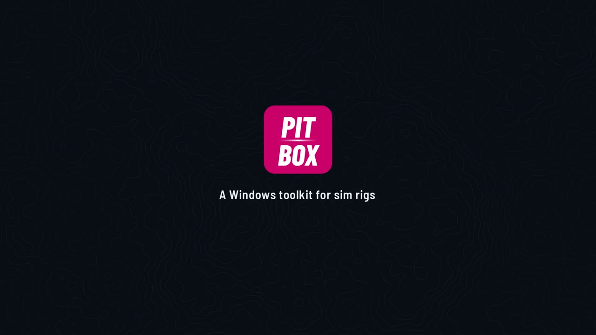
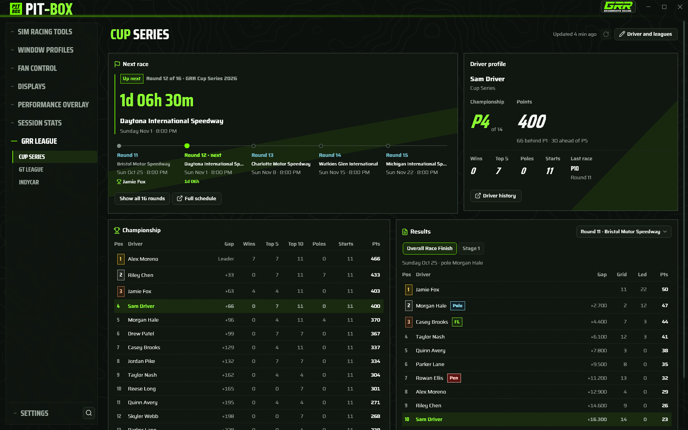

# Pit-Box

**Download: [latest release](https://github.com/king-tulip999/Pit-Box---A-windows-tool-kit-for-sim-racing/releases)** (it's just one `PitBox.exe`, nothing to install)

I got sick of switching monitors, audio, fan curves and overlays by hand every time I went from my desk to my sim rig, so I spent the last year building one app that does it all. It sits in the tray, sets the PC up for whatever I'm doing, and has grown into the toolkit I use every time I race in iRacing: overlays, setups, fuel, and a full history of my sessions with telemetry and replays. Now you get the chance to use it too!

## What's in it

Every tool can be switched off, and when one's off it runs nothing in the background. Every tool sits in a sidebar (drag to reorder), with its sections listed under it. There are themes (The Pits, or your own colors, with presets to start from) over a contour-line background, animations can be switched off in Settings → Appearance, and `Ctrl+F` searches every setting in the app. Keybinds can be keyboard shortcuts or a button on your wheel or button box.

### Sim Racing Tools (iRacing)

#### iRacing Overlay

Relative, Standings, Fuel and strategy, Lap timing and delta, Lap history, Tires, Weather and track, Wind, Session, Race events, Multiclass traffic, Alerts, Track map, a Result card after the race and a Data block for any single value. Every widget can be set up however you like, with layouts that switch by car / class / track, and an in-game editor (`Ctrl+Alt+E`) so you never have to leave the car.

#### iRacing Setup Manager

All your setups sorted by car and class. Rename, move, import share packs and pick up new downloads. Fuel planning lives in the iRacing Overlay's **Fuel** tab.

#### iRacing Controller

iRacing's settings in plain language (search, see what differs from iRacing's defaults and reset it), plus your in-sim keybinds per control profile, grouped the way iRacing groups them, with keys drawn as keycaps and wheel buttons marked. **Find a key** shows what a key combo does, filters show what's set, not set, changed or on the wheel, and setting a key that's already used offers to swap them or keep both. Any change can be undone from its row, and everything gets backed up before it's changed.

#### FOV Calculator

Single and triple screens, compare rigs, and write the result straight into iRacing. It tells you when iRacing's FOV doesn't match your rig, or your side screens aren't at the best angle.

#### Companion apps

Start Trading Paints and Garage 61 with Pit-Box or when iRacing starts, and stop them from the same place. Car pictures across the app can show your own paint.

### Session Stats

Your iRacing history, kept on your PC. Laps, time, results, ratings, incidents and personal bests by week / month / season, with a picture of each car. Every race gets a result card with your finish, positions gained, rating changes, pace, consistency and awards (Win, Podium, Clean race, Personal best, Charger and more). Panels can be dragged into your own order. Open any session for its laps and sectors, then compare laps on telemetry traces or a top-down replay. You can export a lap to share and import other people's. Tire wear is tracked per run from the pit-stall readings. It also reads your old iRacing telemetry files, so your history doesn't start from zero, and can switch on iRacing's telemetry recording and clear out files it has already read.

### Performance Overlay

FPS, 1% lows, average FPS and temperatures, usage and more drawn over your game: drag its readings into whatever order you want, keep several layouts, and reset any of them to the default.

### Fan Control

Curves, presets, calibration and an emergency failsafe. Each fan has its own limits (minimum, fan stop, how fast it may speed up or slow down), and if the hardware stops answering the fans go back to the BIOS / driver until it's back. When you quit you can keep your curves running in a small background helper (its own tray icon), or hand the fans back to the BIOS / driver.

### Window Profiles

Pick a program and give its window an exact size and spot: a game stretched across triple screens, held at a fixed resolution, or moved onto a side screen, with its borders removed. Presets cover your own displays, triple 1080p / 1440p / 4K and common window sizes. Profiles apply when the program starts (with a delay for games that resize themselves), with a keybind, from the tray or with one click, and groups move several programs at once. Each profile shows a small picture of where its window goes on your displays.

### Displays

Turn monitors on and off, arrange them, duplicate one onto another, give them your own names, and set resolution, refresh rate, HDR, taskbar, wallpapers and audio. Save it all as profiles (mine are *Desk* and *Sim rig*) and switch between them with a keybind. Layout changes ask you to keep them and go back by themselves after 15 seconds if you don't.

## Getting started

1. Download `PitBox.exe` and put it somewhere it can stay (e.g. `C:\Tools\PitBox`).
2. Run it. Windows will warn you twice (see below): SmartScreen (**More info → Run anyway**) and the administrator prompt (**Yes**).
3. The setup screen lets you pick a theme, which features you want, and startup options.
4. *Optional:* install the free **PawnIO** driver for CPU temperatures and motherboard fans (Settings → Hardware access → **Install PawnIO**).

Works on Windows 10 and 11 (x64).

## Before you run it

| Question | Answer |
| --- | --- |
| "Windows protected your PC"? | The exe isn't code-signed (certificates cost money every year). Click **More info → Run anyway**. If you want to check your copy, compare `Get-FileHash PitBox.exe` (PowerShell) with `PitBox.exe.sha256` on the release page. |
| Why administrator? | Frame counting, sensors, fan control, display changes and detecting games all need it. With **Start with Windows** on, it starts when you sign in without a prompt. |
| What is PawnIO? | A small, free, open-source, signed driver for CPU sensors and motherboard fans (it replaces WinRing0, which Defender flags). It's optional: without it CPU temperature shows *Not available* and motherboard fans can't be controlled. Everything else works. |
| Safe with anti-cheat? | Nothing gets injected into games. The overlays are separate click-through windows. If a strict anti-cheat ever complains about the driver, uninstall PawnIO. |
| Antivirus flagged it? | Unsigned admin apps that read hardware sometimes trip heuristics. If the checksum matches the release, it's the build I published. |
| What does it send online? | A small ping for the network readout (only while it's on screen), an update check against GitHub releases if you leave that on, and the GRR League feed if you turn that plugin on. No accounts, no telemetry. Your stats stay on your PC. |
| What does it change? | Only what you set up. iRacing files are always backed up first. Fans go back to BIOS / driver control when it quits. |

## Limitations

- The sim racing tools only support iRacing.
- Overlays show over borderless and windowed games, not exclusive fullscreen.
- If Pit-Box gets force-killed (Task Manager → End task), fans stay at their last speed until it restarts or the PC reboots.
- Windows text scaling (100%, 125%…) has no supported API, so the Displays page just links to Windows settings for it.

## Updates and removal

- **Updates:** Settings → About and updates checks on start, daily, weekly or only when you click **Check now**. When there's an update, **Install and restart** downloads it, checks the checksum and swaps the exe. Your settings are kept.
- **Reset:** Settings → Data and configuration → **Reset Pit-Box**. Your old settings are saved as `config.before-reset-<date>.json`, and **Export / Import** lets you back them up or move them to another PC.
- **Uninstall:** turn off **Start with Windows**, quit from the tray (choose **Give fans back and quit** if fan control is on), then delete `PitBox.exe` and `%APPDATA%\PitBox`. If you installed PawnIO, remove it from Windows Settings → Apps.

## GRR League

If you race in the GRR league, turn on the GRR League tool (Settings → Tools → **Choose tools**). It shows your next race and the season's schedule, the championship and results for your class, and where you stand, all from the GRR website without leaving the app. It's off by default, so nobody else sees it.

## Credits

Pit-Box is built on these, each under its own licence:

| What | Used for | Licence |
| --- | --- | --- |
| [LibreHardwareMonitor](https://github.com/LibreHardwareMonitor/LibreHardwareMonitor) | Sensors and fan control | MPL 2.0 |
| [TraceEvent](https://github.com/microsoft/perfview) (Microsoft) | Frame counting for the FPS readouts | MIT |
| [.NET, WPF and Windows Forms](https://github.com/dotnet) (Microsoft) | The app framework | MIT |
| [Lucide](https://lucide.dev) | Icons (some adapted) | ISC |
| [Saira](https://github.com/Omnibus-Type/Saira) by Omnibus-Type | The app font | SIL Open Font License 1.1 |
| [Barlow](https://github.com/jpt/barlow) by Jeremy Tribby | Logo and the iRacing Overlay's numbers | SIL Open Font License 1.1 |
| [SIMRacingApps](https://github.com/SIMRacingApps/SIMRacingAppsServer) by Jeffrey Gilliam | Track centreline and pit lane routes for Session Stats' track maps | Apache 2.0 |
| Track map drawings by [iRacing](https://www.iracing.com), collected in [racing-track-maps-vector](https://github.com/meowmachine/racing-track-maps-vector) by meowmachine | Track maps for Session Stats and the iRacing Overlay | © iRacing.com Motorsport Simulations, LLC |
| [PawnIO](https://pawnio.eu) | Optional driver for CPU and motherboard sensors (not bundled; installed separately) | See its site |

Inspired by (no code or assets from these are used):

- [Fan Control](https://github.com/Rem0o/FanControl.Releases) by Rem0o: the Fan Control page
- [Resize Raccoon](https://github.com/mistenkt/resize-raccoon) by mistenkt and its fork [Resize Rabbit](https://github.com/rosscarlson/resize-rabbit) by rosscarlson: Window Profiles

Thanks to the [GRR League](https://www.grassrootsracing.org) for letting the GRR plugin use its site data and logo.

Full licence texts ship with the components (for example `NOTICES.md` inside the track map library and `Saira-OFL.txt` / `Barlow-OFL.txt` beside the fonts).

iRacing is a trademark of iRacing.com Motorsport Simulations, LLC. Trading Paints and Garage 61 belong to their owners. Pit-Box isn't affiliated with or endorsed by any of them.
